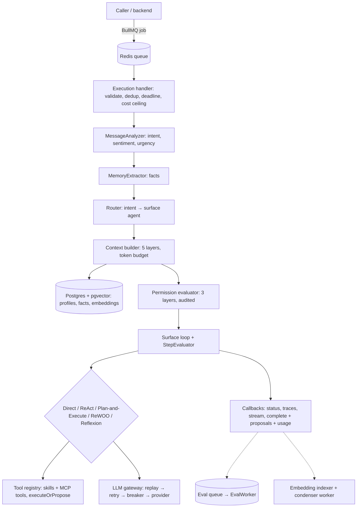

# Bevox Agent Harness

A queue-driven agent runtime in TypeScript. It takes a conversation turn and runs a pre-processing agent pipeline. It then routes the turn to a tool-using agent that picks its own reasoning strategy, assembles context from layered memory under a hard token budget, and gates every tool call through a fail-closed permission system with human-approval modes. The result goes back to the caller through authenticated callbacks.

It is the execution engine of **Bevox**, an AI secretary for appointment-based businesses (clinics first) on WhatsApp and Instagram, built by one person.

> **Status:** v1.0.0. 1,285 tests passing, typecheck and lint clean. Published as a reference implementation of harness design decisions.

## Why a harness

Most agent failures I have seen in production were not model failures. They came from what surrounds the model: context that overflows, memory that costs a tool call per turn, tools that run with too much authority, and loops that retry what should have stopped. This repo is my answer to those problems, written from scratch.

## What's inside

| Area | What it does |
|---|---|
| **Reasoning** | Five engines behind one interface: Direct, ReAct, Plan-and-Execute, ReWOO and a Reflexion wrapper. A rule-based `StepEvaluator` escalates between them at runtime with no LLM router, carrying observations across the swap. |
| **Context** | Five prioritised layers (base config, rules, calendar, memory, history), fetched in parallel with per-layer timeouts. A BPE token budget (`js-tiktoken`, with a fail-open fallback) counts tool schemas too. Compression is iterative and protects the head, and it ends with a guaranteed `finalTokens ≤ budget`. The estimate is calibrated against the provider's reported usage. |
| **Memory** | Three tiers. Working memory holds facts and a profile with supersession. Semantic memory is pgvector HNSW recall that skips turns already in the history. Observational memory is an out-of-band condenser worker. All of it is pre-assembled into context, so the agent never calls a tool to read memory. |
| **Tools & permissions** | One registry for built-in skills and remote MCP tools. A 3-layer, fail-closed `PermissionEvaluator` writes every decision to an audit table. Side-effecting tools use `executeOrPropose()`: they execute only in `autonomous_supervised` mode and return a *proposal* for human approval otherwise. |
| **Bounding** | A global wall-clock deadline, an `AbortController` threaded into the LLM adapters, and a `max_cost_usd` ceiling checked per step. Aborts are a terminal ACK, so the queue never replays a doomed execution. |
| **LLM gateway** | Hand-rolled adapters for OpenAI, Gemini and Anthropic (no vendor SDKs) behind a decorator chain: record/replay → retry → circuit breaker → adapter. It adds a credential pool with cooldown, cost tracking and streaming (ADR-013 explains why streams bypass retry). |
| **Evals** | Sampled online scorers on their own queue: LLM judges (faithfulness returns `null` when ungrounded instead of inventing a score), PII and rule checks, custom rubrics. There is also an offline golden-set CLI. |
| **Deterministic CI** | LLM record/replay cassettes with canonical request hashing and key sanitisation. Strict replay never calls a provider. |
| **MCP, both ways** | A stdio/SSE MCP server with bearer auth exposes the skills, and an MCP client adapts external tools. Both go through the same permission model. |
| **SDR module** | An opt-in sales-development layer that any niche agent turns on with one config field (`sdr_profile`). Doctrine goes into a protected, never-compressed context slot. Qualification (PACT), segmentation (ABCD, with do-not-contact checked before any fit score) and enrichment (3C) are deterministic skills. A 7-touch cadence runs as a durable workflow where the LLM writes the reply but a deterministic rule moves the account state. An eval gate, in English and Portuguese, fails any "qualified" claim made without evidence. Where sales playbooks disagree, the choice is a tunable for A/B tests instead of a hardcoded opinion. |
| **Workflows** | A durable workflow engine (fluent DSL, Postgres state with optimistic locking, suspend/resume). |
| **Observability** | OpenTelemetry spans, Pino, and a dev playground (React) with an execution timeline, span inspector and time-travel replay. |

## Architecture



The harness is worker-only (no inbound HTTP) and scales horizontally. Advanced subsystems sit behind default-off feature flags (`STREAM_ENABLED`, `RAG_ENABLED`, `OTEL_ENABLED`, `CONTEXT_BUILDER_ENABLED`, `MEMORY_SEMANTIC_RECALL_ENABLED`, …).

## Quick start

The test suite needs no API keys and no infrastructure. LLM calls replay from cassettes, and the DB-backed integration suites skip themselves when no database is configured.

```bash
git clone https://github.com/bernardTavares/bevox-agent-harness.git
cd bevox-agent-harness
npm ci
npm run build
npm test                      # 1,285 passing, 57 skipped
npm run playground            # dev playground
```

Running the worker for real is more involved, and these are the known rough edges:
- Postgres needs **pgvector** and **pg_uuidv7**. Plain `postgres:16-alpine` from `docker-compose.yml` is not enough.
- Migration `001` references an `accounts` table that the harness never creates. Create a stub `accounts(id integer primary key)` before `npm run db:migrate` and drop it afterwards.
- The harness is a worker and expects a backend that enqueues `ExecutionPayload` jobs and receives the HTTP callbacks. `openapi/agent-harness-v1.yaml` and `skills/bevox-agent-harness-consumer/` describe that contract.

## How this was built

As one person, AI-native:
- every non-trivial change started as a design spec (`docs/superpowers/specs/`) and an implementation plan (`docs/superpowers/plans/`);
- Claude Code subagents executed the plans in parallel git worktrees, under repo-local rules, hooks and reviewer agents (`.claude/`, `CLAUDE.md`);
- scheduled multi-agent audits then tried to break each claim end to end.

Those audits are why this release exists in its current form. They found features that were unit-green but not wired into the live path, such as Reflexion notes that no engine read and a recall getter with no caller. The fixes and invariant tests are merged here.

The design docs, specs and audits were written in Portuguese. The code, the API and this README are in English.

## License

[Functional Source License 1.1, MIT Future License](./LICENSE.md) (FSL-1.1-MIT). Copyright 2026 Bernard Tavares.

You may use, modify and redistribute it for any purpose except a competing commercial product or service. Each version becomes MIT-licensed two years after its release.
